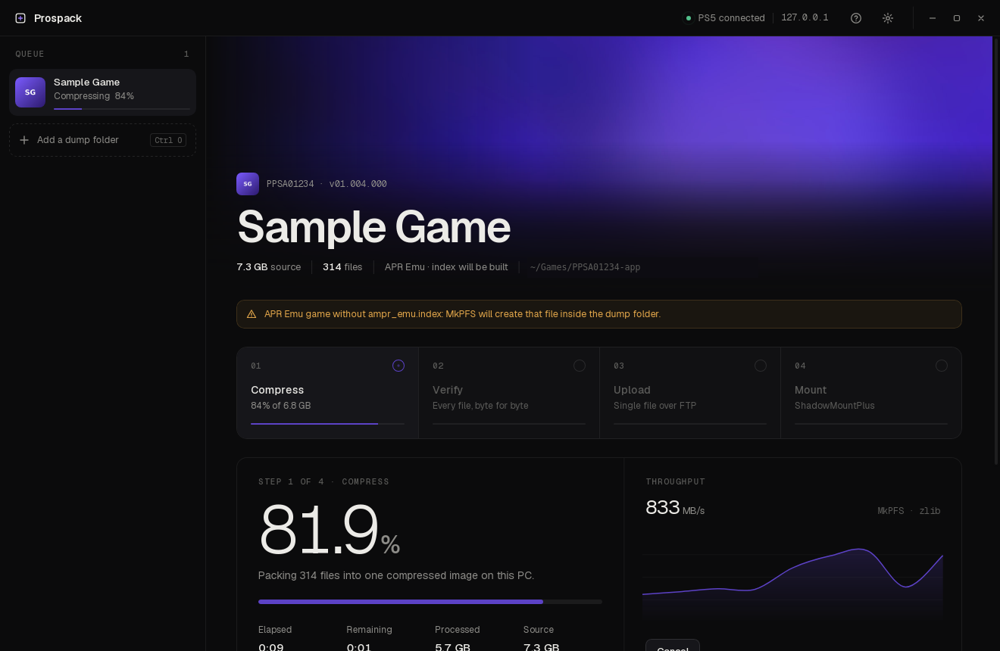

<p align="center">
  
</p>

<h1 align="center">Prospack</h1>

<p align="center"><b>Pack, verify and send PS5 dumps as <code>.ffpfsc</code>, from your PC.</b></p>

<p align="center">
  <a href="https://github.com/unicxrn/prospack/releases/latest">Download</a> ·
  <a href="#quick-start">Quick start</a> ·
  <a href="#troubleshooting">Troubleshooting</a>
</p>



Prospack turns a PS5 game dump into a single compressed `.ffpfsc` image on your PC, checks
every file in it against the dump, uploads it to your PS5 over FTP, and gets
ShadowMountPlus to mount it.

It does the same job as compressing with Game Compressor on the console, but your PC does
the heavy lifting:
- **Faster.** Compression runs at hundreds of MB/s on a desktop CPU.
- **Less to send.** One file, usually 40–60% smaller, instead of tens of thousands of loose
  files over FTP.
- **Checked before it leaves your PC.** A bad image never reaches the console.

## Download

| Platform | Get |
| --- | --- |
| **Windows 10/11** | `Prospack-Setup-<version>.exe` from [Releases](https://github.com/unicxrn/prospack/releases/latest) |
| **Linux** | `.AppImage` (any distro) or `.deb` (Debian/Ubuntu) from [Releases](https://github.com/unicxrn/prospack/releases/latest) |

Everything is included. You don't need Python or anything else.

> **Windows shows "Windows protected your PC"?** The installer isn't code-signed, so
> SmartScreen warns about it. Click **More info → Run anyway**. You can check the
> download against the SHA-256 on the release page.

## You'll need

- A **jailbroken PS5** running an **FTP server**: ftpsrv (port 2121) or etaHEN (port 1337).
- **ShadowMountPlus** running on the PS5, so the game shows up.
- A **game dump folder**: the one containing `sce_sys/` and `eboot.bin`, such as `PPSA01234-app`.
- Room on your PC for the image while it's made, up to the size of the dump.

## Quick start

1. Open Prospack. Setup finds your PS5 on the network and checks that ShadowMountPlus is there.
2. Pick where images are kept on your PC.
3. Drop a dump folder on the window, or press **Ctrl O**.
4. Leave it running. Each game goes through four steps on its own:

| Step | What happens |
| --- | --- |
| **Compress** | [MkPFS](https://github.com/PSBrew/MkPFS) packs the dump into `<TITLE>.ffpfsc`: an exFAT image inside a compressed PFS container, the same format Game Compressor makes. |
| **Verify** | Every file is read back out of the image and compared with the dump, byte for byte. If anything differs, the job stops before uploading. |
| **Upload** | One file to `/data/homebrew` under a hidden name until it's complete, then renamed. It resumes if interrupted and never overwrites an existing image. |
| **Mount** | ShadowMountPlus is told about the image and Prospack waits until it's mounted. |

You can queue as many games as you like. The **?** button inside the app explains every
screen.

## What Prospack changes

- **Your dump folder** is only read. The one exception is APR Emu games without an
  `ampr_emu.index`: MkPFS adds one to the folder, because the game needs it.
- **On your PC:** the `.ffpfsc` image goes in your image folder. You can have it deleted
  automatically once the PS5 confirms the mount.
- **On your PS5:**
  - `/data/homebrew/<TITLE>.ffpfsc`: the image.
  - `/data/shadowmount/autotune.ini`: `image_sector=<TITLE>.ffpfsc:65536`.
  - `/data/shadowmount/config.ini`: `image_ro=<TITLE>.exfat`.
  - `/data/shadowmount/manual.lst`: the image path. Rewriting this file makes
    ShadowMountPlus scan for it.
  - `/data/GameCompressor/validations/<TITLE>-<hash>.json`: only if you use Game
    Compressor. It makes Game Compressor show the game as validated, along with its
    original size and space saved.

  These are the same settings Game Compressor writes for its own images. Every file is
  backed up on your PC before it's changed.

## Troubleshooting

<details><summary><b>Prospack can't find my PS5</b></summary>

- Check the PS5 is on, jailbroken, and running an FTP server (ftpsrv on 2121 or etaHEN on 1337).
- The PC and the PS5 must be on the same network. Guest Wi-Fi and VPNs often separate them.
- Enter the IP yourself: **Settings → Run setup again → "Not listed? Enter it yourself"**.
  The PS5 shows its IP under Settings → Network.
</details>

<details><summary><b>Verify failed</b></summary>

The image didn't match the dump, so nothing was uploaded. Choose **Compress again**. If it
keeps failing, the dump itself may be incomplete or on a failing drive: copy it again.
</details>

<details><summary><b>Mount not confirmed</b></summary>

The image is on the PS5, but ShadowMountPlus hadn't mounted it within five minutes. Check
the PS5's home screen, then use **Check again**. Restarting ShadowMountPlus also triggers a
scan.
</details>

<details><summary><b>"The PS5 already has a different image"</b></summary>

Prospack never overwrites. Delete or rename the existing `<TITLE>.ffpfsc` on the PS5, then
**Retry**.
</details>

<details><summary><b>The game shows up but won't start</b></summary>

That's on the PS5 side, not the image. Check your ShadowMountPlus version, backports, and
the game's firmware requirement. ShadowMountPlus logs to `/data/shadowmount/debug.log`.
</details>

## Building from source

```bash
npm install
python -m pip install -r engine/requirements-build.txt
python engine/build.py          # freezes the engine into src-tauri/binaries/
npx tauri build
```

See [CONTRIBUTING.md](CONTRIBUTING.md) for the development setup and tests.

## Credits

- [MkPFS](https://github.com/PSBrew/MkPFS) does the compression and image reading.
- Prospack is made to work with
  [ShadowMountPlus](https://github.com/drakmor/ShadowMountPlus),
  [Game Compressor](https://github.com/juma-sayeh/PS5-Game-Compressor) and
  [ftpsrv](https://github.com/ps5-payload-dev/ftpsrv).

Thanks to their authors.

Only use dumps of games you own.

## License

[GPL-3.0](LICENSE).
